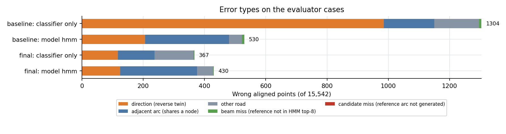
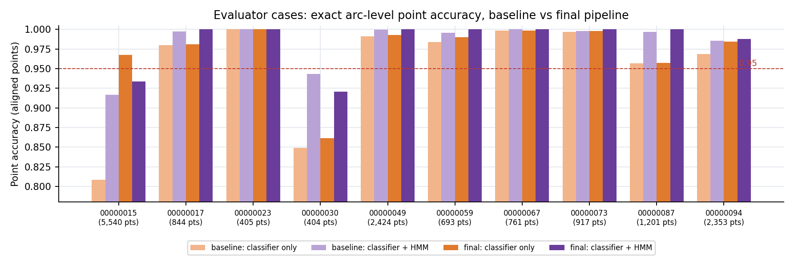

# PathSnap — Evaluator Dataset Evaluation Report

**Data:** `data/external_evaluator/evaluator_test (1) (1).zip`, 10 cases (`.track`, `.nodes`, `.arcs`, `.route`).

**Scripts:**
- `scripts/evaluate_evaluator.py`: evaluation.
- `scripts/experiment_adaptive_heading.py` and `scripts/experiment_adaptive_decoder.py`: development-data experiments.
- `scripts/build_evaluator_report.py`: this report.

Every number below is read from files in `results/evaluator/` and `results/adaptive_heading/`.

## 1. Summary

| | Baseline (Phase 4 model + Phase 5 decoder) | Final (adopted on development data) |
|---|---|---|
| **Point accuracy, classifier + HMM (pooled, 15,542 aligned points)** | **96.59%** | **97.23%** |
| Point accuracy, mean over the 10 cases | 98.33% | 98.42% |
| Cases ≥ 95% point accuracy | 8/10 | 8/10 |
| Route arc F1 (mean over cases) | 0.9598 | 0.9667 |
| Route continuity (mean) | 1.0000 | 1.0000 |
| Exact route reproduced | 0/10 | 0/10 |
| Classifier Top-1 / Top-3 / MRR (pooled) | 0.9161 / 0.9965 / 0.9560 | 0.9764 / 0.9979 / 0.9872 |
| Candidate coverage (reference arc generated) | 100.00% | 100.00% |

**Against the 95% target.** No official evaluator scoring formula exists in the project materials (§4). On the closest official definition, the guidelines' *observation-level Top-1 accuracy* applied to the final decisions, the deployed pipeline reaches **97.23%** pooled and **98.42%** as the mean over cases.

95% is **not** reached on every view:
- Cases 00000015 (93.34%) and 00000030 (92.08%) are below 95%.
- The mean route arc F1 is 0.9667.
- No case reproduces the reference route exactly.

**Data separation.** Nothing was trained, tuned or selected on the evaluator data. The pipeline change in §7 was chosen by rules fixed in advance and evaluated on the 80 training trips (cross-validation) and reported on the 10 student-test trips. The evaluator was then run once.

That change was prompted by *diagnosing* evaluator case 00000015 (§6). The same weakness was already visible in the development data, and the decision itself used development data only. Keep this in mind when citing the final number: it is not a fully blind number in the strictest sense. The baseline number is.

## 2. Data, file formats and loader

**Format.** The files are identical in format to the training data: headerless, whitespace-separated, and `.track` uses CRLF line endings. They are parsed by the same `io.read_table` / `io.load_trip`:

| File | Columns | IDs |
|---|---|---|
| `.track` | lon, lat, t (s) | GPS row = observation (not linked to node or arc rows) |
| `.nodes` | lon, lat | row index = node_id, 0-based |
| `.arcs` | from_node, to_node | row index = arc_id, 0-based |
| `.route` | arc_id | chronological reference arcs |

**Dedicated loader.** `src/pathsnap/evaluator_data.py`, configured by the `evaluator:` section of `config.yaml`:

- Extracts the ZIP to `data/external_evaluator/evaluator_test/<id>/`. This is outside `data/raw/`, so training code that lists `data/raw/train` can never see these cases.
- Writes only members named `<id>/<id>.<track|nodes|arcs|route>`. Paths and other names are ignored (tested).
- Validates every case (`results/evaluator/manifest.json`).

**Route indexing convention: 0-based, verified.** In every case, all route IDs are in 0..n_arcs−1, and 100% of consecutive route arcs are connected (to-node of arc k = from-node of arc k+1) when read 0-based. Read 1-based, at most 18.5% would be. All files parse with no malformed rows. No case shares an ID or a byte-identical `.track` with the training or student-test data.

| Case | GPS pts | Nodes | Arcs | Route arcs | Route ids in 0..n−1 | Consecutive route arcs connected, 0-based | … if read 1-based | ID / content overlap with dev data | Malformed rows |
|---|---|---|---|---|---|---|---|---|---|
| 00000015 | 6854 | 1571 | 3225 | 136 | 100.00% | 100.00% | 1.48% | no | 0 |
| 00000017 | 1346 | 36724 | 76425 | 795 | 100.00% | 100.00% | 2.64% | no | 0 |
| 00000023 | 458 | 5053 | 10596 | 59 | 100.00% | 100.00% | 0.00% | no | 0 |
| 00000030 | 654 | 13223 | 24218 | 337 | 100.00% | 100.00% | 9.52% | no | 0 |
| 00000049 | 2642 | 23165 | 47542 | 410 | 100.00% | 100.00% | 0.98% | no | 0 |
| 00000059 | 1031 | 12631 | 24024 | 455 | 100.00% | 100.00% | 4.85% | no | 0 |
| 00000067 | 916 | 2265 | 4485 | 82 | 100.00% | 100.00% | 0.00% | no | 0 |
| 00000073 | 1144 | 12151 | 25631 | 238 | 100.00% | 100.00% | 4.64% | no | 0 |
| 00000087 | 1399 | 55234 | 107451 | 455 | 100.00% | 100.00% | 18.50% | no | 0 |
| 00000094 | 3230 | 6815 | 14931 | 604 | 100.00% | 100.00% | 0.66% | no | 0 |

## 3. Compatibility with the pipeline

The unchanged pipeline (preprocessing, STRtree candidates, the 23 features, the model, HMM/Viterbi and route reconstruction) ran on all 10 cases without modification or errors, through the same `inference.match_trip` used by the API.

- **Candidates:** coverage is 100.00%, so the reference arc of every aligned point is among the generated candidates. There are no candidate-generation failures.
- **HMM beam:** it contains the reference for 99.95% of points.
- **Label coverage:** 0.74% of GPS points are unalignable (more than 40 m from the route) and 20.26% are ambiguous (junction nodes).
- **API check:** serving the evaluator cases with `PATHSNAP_RAW_DIR=data/external_evaluator PATHSNAP_PARTITION=evaluator_test` returns the same per-case numbers as this report. This was checked on cases 00000015, 00000030, 00000087 and 00000094, also from a fresh install of the packaged backend.

## 4. Metrics and the official scoring formula

**Search result.** `Main Guidelines.pdf`, `Models and Training Guidelines.pdf`, `Deliverables.pdf`, `Dataset Exploration.pdf`, `Assessment and Plagiarism Policy.pdf` and the project code were searched. **No official evaluator scoring formula exists.** What the materials do say:
- The API "calculates prediction accuracy using its internal reference data".
- *Observation-level Top-1 accuracy* is defined: "for each GPS observation, select the candidate with the highest predicted score and compare it with the corresponding reference road segment".
- Route continuity and sequence-level performance should be reported.

No formula was invented. All metrics below are reported, and "point accuracy" is treated as the primary metric.

**Metric definitions** (implemented in `inference.evaluate_match` and `scripts/evaluate_evaluator.py`):

- **Aligned points.** The reference `.route` is aligned to the GPS points by the Phase 2 order-preserving alignment, the same code used for training labels. A point is *aligned* if one reference arc is assigned within 40 m (20 m if stationary). It is *ambiguous* if another route arc within ±2 positions lies within 2 m (a junction node), and *unalignable* otherwise.
- **Point accuracy (exact arc-level).** The share of aligned points whose output arc equals the aligned reference arc. *Pooled* = over all points of all cases; *mean of cases* = average of per-case values.
- **Ambiguous (lenient).** Ambiguous points count as correct if the output is the aligned arc or a labelled alternative.
- **Top-k, MRR.** The rank of the aligned arc among the point's candidates, ordered by classifier probability (aligned points).
- **Continuity.** The share of consecutive point pairs (time gap ≤ 60 s) whose arcs are equal or connected by a feasible directed path.
- **Route arc P/R/F1.** The reconstructed route compared with the reference route, as arc sets. *Length F1* weights each arc by its length. *Route mismatch* = (length wrongly added + length missed) / reference length [Newson & Krumm 2009].
- **Route-level accuracy.** Whether the reconstructed arc sequence equals the reference sequence exactly.
- **Decision precision/recall/F1.** Over the candidate rows of aligned points: positive = the aligned arc, predicted = the chosen arc.

## 5. Baseline results (Phase 4 model + Phase 5 decoder, unchanged)

| Method | Point acc. (pooled) | Point acc. (mean of cases) | Cases ≥ 95% | Ambig. lenient | Continuity | Arc P | Arc R | Arc F1 | Length F1 | Route mismatch | Route breaks (mean) |
|---|---|---|---|---|---|---|---|---|---|---|---|
| Nearest road | 50.93% | 55.05% | 0/10 | 0.5160 | 0.9108 | 0.5717 | 0.8615 | 0.6838 | 0.6368 | 0.8659 | 127.5 |
| Classifier only | 91.61% | 95.33% | 8/10 | 0.8649 | 0.9767 | 0.8127 | 0.9879 | 0.8821 | 0.9143 | 0.2341 | 45.2 |
| Distance-only HMM | 95.49% | 97.40% | 8/10 | 0.8782 | 0.9998 | 0.8690 | 0.9880 | 0.9199 | 0.9719 | 0.0601 | 0.6 |
| Classifier + HMM (deployed) | 96.59% | 98.33% | 8/10 | 0.9273 | 1.0000 | 0.9339 | 0.9930 | 0.9598 | 0.9816 | 0.0392 | 0.2 |

Per case (classifier + HMM unless the column says otherwise):

| Case | GPS pts | Aligned | Ambig. | Unalign. | Nearest | Classifier | Clf+HMM | Ambig. lenient | Top-3 | MRR | Continuity | Arc P | Arc R | Arc F1 | Mismatch | Ref / pred arcs | Exact route |
|---|---|---|---|---|---|---|---|---|---|---|---|---|---|---|---|---|---|
| 00000015 | 6854 | 5540 | 1169 | 145 | 0.4000 | 0.8081 | 0.9168 | 0.8358 | 0.9935 | 0.9001 | 0.9999 | 0.6537 | 0.9853 | 0.7859 | 0.2316 | 136 / 361 | no |
| 00000017 | 1346 | 844 | 502 | 0 | 0.4479 | 0.9799 | 0.9976 | 0.9462 | 0.9988 | 0.9886 | 1.0000 | 0.9458 | 1.0000 | 0.9722 | 0.0116 | 795 / 857 | no |
| 00000023 | 458 | 405 | 53 | 0 | 0.4272 | 1.0000 | 1.0000 | 0.7925 | 1.0000 | 1.0000 | 1.0000 | 0.9365 | 1.0000 | 0.9672 | 0.0032 | 59 / 63 | no |
| 00000030 | 654 | 404 | 250 | 0 | 0.6535 | 0.8490 | 0.9431 | 0.8480 | 0.9950 | 0.9212 | 1.0000 | 0.9348 | 0.9792 | 0.9565 | 0.0508 | 337 / 366 | no |
| 00000049 | 2642 | 2424 | 218 | 0 | 0.5615 | 0.9909 | 0.9996 | 1.0000 | 1.0000 | 0.9954 | 1.0000 | 1.0000 | 0.9976 | 0.9988 | 0.0012 | 410 / 409 | no |
| 00000059 | 1031 | 693 | 338 | 0 | 0.4762 | 0.9841 | 0.9957 | 0.9852 | 1.0000 | 0.9918 | 1.0000 | 0.9579 | 1.0000 | 0.9785 | 0.0170 | 455 / 489 | no |
| 00000067 | 916 | 761 | 155 | 0 | 0.4796 | 0.9987 | 1.0000 | 0.9806 | 1.0000 | 0.9993 | 1.0000 | 0.9878 | 0.9878 | 0.9878 | 0.0435 | 82 / 82 | no |
| 00000073 | 1144 | 917 | 226 | 1 | 0.7797 | 0.9967 | 0.9978 | 0.9956 | 1.0000 | 0.9982 | 1.0000 | 0.9875 | 1.0000 | 0.9937 | 0.0060 | 238 / 246 | no |
| 00000087 | 1399 | 1201 | 198 | 0 | 0.7785 | 0.9567 | 0.9967 | 0.9293 | 1.0000 | 0.9782 | 1.0000 | 0.9717 | 0.9802 | 0.9759 | 0.0115 | 455 / 459 | no |
| 00000094 | 3230 | 2353 | 877 | 0 | 0.5011 | 0.9686 | 0.9856 | 0.9601 | 0.9936 | 0.9817 | 1.0000 | 0.9633 | 1.0000 | 0.9813 | 0.0160 | 604 / 695 | no |

## 6. Error analysis and bottleneck



| Run | Decision | Wrong points | direction (reverse twin) | adjacent arc (shares a node) | other road | beam miss (reference not in HMM top-8) | candidate miss (reference arc not generated) | unmatched (no arc output) | Stationary share |
|---|---|---|---|---|---|---|---|---|---|
| baseline | classifier only | 1304 | 985 (76%) | 165 (13%) | 146 (11%) | 8 (1%) | 0 (0%) | 0 (0%) | 8.67% |
| baseline | model hmm | 530 | 206 (39%) | 274 (52%) | 42 (8%) | 8 (2%) | 0 (0%) | 0 (0%) | 14.91% |
| final | classifier only | 367 | 118 (32%) | 119 (32%) | 128 (35%) | 2 (1%) | 0 (0%) | 0 (0%) | 12.81% |
| final | model hmm | 430 | 125 (29%) | 251 (58%) | 52 (12%) | 2 (0%) | 0 (0%) | 0 (0%) | 4.19% |

**Error types.**
- *Direction:* the output is the reverse twin of the reference arc.
- *Adjacent:* the output shares a node with the reference (the transition to the next arc is early or late).
- *Other road:* e.g. a parallel street.
- *Beam miss:* the reference was a candidate but not among the HMM's top-8 states.
- *Candidate miss:* the reference was never generated. This never happened.
- *Transition errors:* continuity is ≈ 1.0, so the final routes contain no disconnected transitions.
- *Sequence-reconstruction errors* show up as extra arcs: the predicted route is longer than the reference in most cases, which lowers arc precision.

**Bottleneck: one slow case.** In the baseline, case 00000015 holds 87% of all wrong points of the deployed decision. Its GPS inputs (no labels involved) show a trace that moves at walking pace:

- The net displacement over 30 s is 1.30 m/s, with 97% of 30-s windows below 2 m/s.
- The 1 s step speed reads 7.19 m/s because the GPS jitter (~5 m) exceeds the real per-second movement.
- The old preprocessing therefore produced a "reliable" heading (≥ 5 m over ±3 s) that is mostly noise. This is exactly the feature that separates the two directions of a road.

Supporting observation (uses labels, diagnosis only): on correct points of 00000015, 10.6% of the reference arcs point more than 90° away from the GPS movement, against 1–2% on other cases. So its reference is also less consistent with the observed motion.

**The same weakness exists in the development data:**
- The five slowest *training* trips by 30-s displacement (00000033, 00000054, 00000010, 00000002, 00000082) include the four worst training trips (out-of-fold HMM accuracy 0.67–0.85).
- Student-test trip 00000077 (2.76 m/s) is the worst student-test trip.
- The Phase 4 error analysis had already found "no reliable heading" and "stationary" to be the two largest error sources.

| Partition | Trip | Speed, 30 s net displacement (m/s) | Speed, 1 s steps (m/s) | Share of 30 s windows < 2 m/s | Dev. HMM point acc. |
|---|---|---|---|---|---|
| evaluator_test | 00000015 | 1.3 | 7.19 | 0.967 | — |
| evaluator_test | 00000017 | 14.09 | 15.54 | 0.035 | — |
| evaluator_test | 00000023 | 23.72 | 22.37 | 0.0 | — |
| evaluator_test | 00000030 | 13.5 | 16.28 | 0.077 | — |
| evaluator_test | 00000049 | 20.9 | 22.1 | 0.0 | — |
| evaluator_test | 00000059 | 11.44 | 14.03 | 0.0 | — |
| evaluator_test | 00000067 | 5.96 | 9.58 | 0.037 | — |
| evaluator_test | 00000073 | 10.59 | 12.78 | 0.09 | — |
| evaluator_test | 00000087 | 30.61 | 28.85 | 0.001 | — |
| evaluator_test | 00000094 | 4.72 | 9.87 | 0.062 | — |
| student_test | 00000000 | 23.57 | 22.05 | 0.028 | 0.9915 |
| student_test | 00000007 | 17.51 | 18.11 | 0.13 | 0.9823 |
| student_test | 00000009 | 9.86 | 12.43 | 0.013 | 0.9448 |
| student_test | 00000040 | 18.77 | 17.57 | 0.066 | 0.9909 |
| student_test | 00000052 | 20.74 | 21.1 | 0.0 | 1.0000 |
| student_test | 00000056 | 14.13 | 17.21 | 0.038 | 0.9921 |
| student_test | 00000065 | 8.12 | 12.04 | 0.103 | 0.9961 |
| student_test | 00000076 | 6.05 | 9.88 | 0.102 | 0.9922 |
| student_test | 00000077 | 2.76 | 8.5 | 0.431 | 0.9092 |
| student_test | 00000091 | 9.85 | 12.76 | 0.062 | 0.9581 |

## 7. Improvement: adaptive feature heading (decided on development data only)

**Change.** The heading used by the *features* (`feat_bearing`, `feat_bearing_valid`; `src/pathsnap/preprocessing.py`) grows its centred window from ±3 s up to ±30 s until the displacement reaches 20 m. It is marked valid only then.

- **Setting:** one principled value, about 4× the median GPS noise of 4.6 m, chosen without tuning.
- **Unchanged:** labels, evaluation and the HMM still use the original heading, so the training labels and the scoring reference stay the same. This was asserted: the candidates and labels are identical.
- **Default:** `feature_bearing_mode: fixed` reproduces all earlier features exactly. This was checked on 61k rows, and a test covers it.

**Stage 1, model** (rule fixed before running: adopt iff mean CV Top-1 (5 Phase 3 trip-grouped folds) improves AND pooled out-of-fold HMM point accuracy on the 80 training trips improves; model hyperparameters and decoder settings fixed; student-test reported only; evaluator data not used). Tuned hyperparameters unchanged, same 5 trip-grouped folds; the current-model values reproduce Phase 4 exactly:

| Fold | Top-1 current | Top-1 adaptive | Macro F1 current | Macro F1 adaptive | Log loss current | Log loss adaptive |
|---|---|---|---|---|---|---|
| 1 | 0.9216 | 0.9630 | 0.9326 | 0.9580 | 0.0711 | 0.0495 |
| 2 | 0.9524 | 0.9610 | 0.9541 | 0.9626 | 0.0473 | 0.0415 |
| 3 | 0.8797 | 0.8851 | 0.9043 | 0.9144 | 0.0768 | 0.0718 |
| 4 | 0.9289 | 0.9594 | 0.9447 | 0.9603 | 0.0600 | 0.0478 |
| 5 | 0.9304 | 0.9430 | 0.9429 | 0.9506 | 0.0593 | 0.0513 |

- **Cross-validation:** CV Top-1 0.9226 → **0.9423**, better in 5/5 folds. Macro F1 0.9357 → 0.9492; log loss 0.0629 → 0.0524.
- **Training out-of-fold:** classifier-only 92.53% → 94.87%. HMM with the old decoder 95.04% → 95.22% (42 trips better, 17 worse).
- **Outcome:** adopted = True.

**Stage 2, decoder re-tuned for the new model** (rule: replace the current pipeline only if pooled training out-of-fold HMM point accuracy of (adaptive model + decoder re-tuned with the Phase 5 grid on training OOF) exceeds the current pipeline's; student-test reported only). The Phase 5 grid on training out-of-fold probabilities selected β = 5 m, w = 2.

- **Training out-of-fold point accuracy:** 95.04% → **95.34%**. The grid is flat: all settings are within 0.06 pp.
- **Student test** (reported only): point accuracy 97.30% → 97.32%; mean route F1 0.9767 → 0.9793.
- **Outcome:** adopted = True.

**Honest size of the effect.** The classifier gains are large. After decoding, the end-to-end gain on development data is small (+0.3 pp on training, flat on the student test). The slowest development trips did **not** improve after decoding (e.g. student-test 00000077: 0.9092 → 0.8949).

**Deployment.** `config.yaml → final_pipeline` points to `artifacts/adaptive_heading/final_model.json` and `results/adaptive_heading/hmm_params.json`. The preprocessing override travels with the model (`preprocessing_overrides`), and `match_trip` applies it automatically, so a model can never receive features built differently from its training. Removing the two `final_pipeline` lines restores the Phase 4/5 pipeline.

## 8. Final results on the evaluator (single run of the adopted pipeline)



| Method | Point acc. (pooled) | Point acc. (mean of cases) | Cases ≥ 95% | Ambig. lenient | Continuity | Arc P | Arc R | Arc F1 | Length F1 | Route mismatch | Route breaks (mean) |
|---|---|---|---|---|---|---|---|---|---|---|---|
| Nearest road | 50.93% | 55.05% | 0/10 | 0.5160 | 0.9108 | 0.5717 | 0.8615 | 0.6838 | 0.6368 | 0.8659 | 127.5 |
| Classifier only | 97.64% | 97.31% | 9/10 | 0.8933 | 0.9772 | 0.8372 | 0.9847 | 0.8982 | 0.9329 | 0.1659 | 42.5 |
| Distance-only HMM | 95.49% | 97.40% | 8/10 | 0.8782 | 0.9998 | 0.8690 | 0.9880 | 0.9199 | 0.9719 | 0.0601 | 0.6 |
| Classifier + HMM (deployed) | 97.23% | 98.42% | 8/10 | 0.9592 | 1.0000 | 0.9446 | 0.9933 | 0.9667 | 0.9859 | 0.0300 | 0.2 |

Per case:

| Case | GPS pts | Aligned | Ambig. | Unalign. | Nearest | Classifier | Clf+HMM | Ambig. lenient | Top-3 | MRR | Continuity | Arc P | Arc R | Arc F1 | Mismatch | Ref / pred arcs | Exact route |
|---|---|---|---|---|---|---|---|---|---|---|---|---|---|---|---|---|---|
| 00000015 | 6854 | 5540 | 1169 | 145 | 0.4000 | 0.9675 | 0.9334 | 0.9059 | 0.9968 | 0.9823 | 0.9999 | 0.7500 | 0.9706 | 0.8462 | 0.2090 | 136 / 271 | no |
| 00000017 | 1346 | 844 | 502 | 0 | 0.4479 | 0.9810 | 1.0000 | 0.9681 | 1.0000 | 0.9895 | 1.0000 | 0.9572 | 1.0000 | 0.9781 | 0.0103 | 795 / 841 | no |
| 00000023 | 458 | 405 | 53 | 0 | 0.4272 | 1.0000 | 1.0000 | 0.8679 | 1.0000 | 1.0000 | 1.0000 | 0.8429 | 1.0000 | 0.9147 | 0.0094 | 59 / 73 | no |
| 00000030 | 654 | 404 | 250 | 0 | 0.6535 | 0.8614 | 0.9208 | 0.8880 | 0.9975 | 0.9284 | 1.0000 | 0.9429 | 0.9792 | 0.9607 | 0.0472 | 337 / 358 | no |
| 00000049 | 2642 | 2424 | 218 | 0 | 0.5615 | 0.9930 | 1.0000 | 1.0000 | 1.0000 | 0.9964 | 1.0000 | 1.0000 | 0.9976 | 0.9988 | 0.0012 | 410 / 409 | no |
| 00000059 | 1031 | 693 | 338 | 0 | 0.4762 | 0.9899 | 1.0000 | 0.9941 | 1.0000 | 0.9947 | 1.0000 | 0.9870 | 1.0000 | 0.9934 | 0.0035 | 455 / 467 | no |
| 00000067 | 916 | 761 | 155 | 0 | 0.4796 | 0.9987 | 1.0000 | 1.0000 | 1.0000 | 0.9993 | 1.0000 | 1.0000 | 0.9878 | 0.9939 | 0.0051 | 82 / 81 | no |
| 00000073 | 1144 | 917 | 226 | 1 | 0.7797 | 0.9978 | 1.0000 | 0.9823 | 1.0000 | 0.9987 | 1.0000 | 0.9916 | 1.0000 | 0.9958 | 0.0020 | 238 / 244 | no |
| 00000087 | 1399 | 1201 | 198 | 0 | 0.7785 | 0.9575 | 1.0000 | 1.0000 | 1.0000 | 0.9786 | 1.0000 | 1.0000 | 0.9978 | 0.9989 | 0.0046 | 455 / 454 | no |
| 00000094 | 3230 | 2353 | 877 | 0 | 0.5011 | 0.9843 | 0.9877 | 0.9852 | 0.9945 | 0.9901 | 1.0000 | 0.9742 | 1.0000 | 0.9869 | 0.0073 | 604 / 668 | no |

**Changes against the baseline:**
- Pooled point accuracy 96.59% → 97.23%; ambiguous-lenient accuracy 0.9273 → 0.9592; route arc F1 0.9598 → 0.9667.
- Seven cases are at 100% point accuracy.

**Regressions:**
- Case 00000030: 0.9431 → 0.9208.
- Case 00000023's route arc F1: 0.9672 → 0.9147, with point accuracy still 1.0. The reconstructed route adds 14 arcs.

**Observation not acted on.** On the evaluator, the final *classifier alone* (97.64% pooled) scores higher than classifier + HMM (97.23%). This is entirely because the HMM degrades slow case 00000015 (0.9675 → 0.9334). On development data the HMM is better: training 95.34% vs 94.87%, student test 97.32% vs 95.87%.

Switching the deployed decoder because of this evaluator result would be selection on evaluator data, which `Dataset Exploration.pdf` forbids. It was therefore **not** done.

## 9. Remaining causes of error and next steps

**Remaining causes:**
- 86% of the final wrong points are in case 00000015. The main type is adjacent-arc, a transition timing offset along the route, followed by direction errors. Both are consistent with walking-pace movement, where GPS jitter (`d_gps`) dominates the HMM's transition term.
- Extra arcs in reconstructed routes come from shortest-path joining between consecutive matches. They lower arc precision (0.9446) more than recall (0.9933).

**Next steps.** Each must be decided on training/student-test data before another evaluator run:
1. Speed-aware decoding for slow segments: smooth `d_gps` over a displacement window, or raise the emission weight when the 30-s displacement speed is low.
2. Collapse back-and-forth detours in route reconstruction.

## 10. Reproduce

```bash
source venv/bin/activate
python scripts/evaluate_evaluator.py --which phase4 --tag baseline   # baseline (Phase 4 model + Phase 5 decoder)
python scripts/experiment_adaptive_heading.py                       # stage 1 (training/student-test only)
python scripts/experiment_adaptive_decoder.py                       # stage 2 (training/student-test only)
python scripts/evaluate_evaluator.py --which final --tag final       # adopted pipeline, evaluator
python scripts/evaluator_report_figures.py && python scripts/build_evaluator_report.py
python -m pytest tests -q                                            # 74 passed
PATHSNAP_RAW_DIR=data/external_evaluator PATHSNAP_PARTITION=evaluator_test bash scripts/start_api.sh   # serve the 10 cases
```
